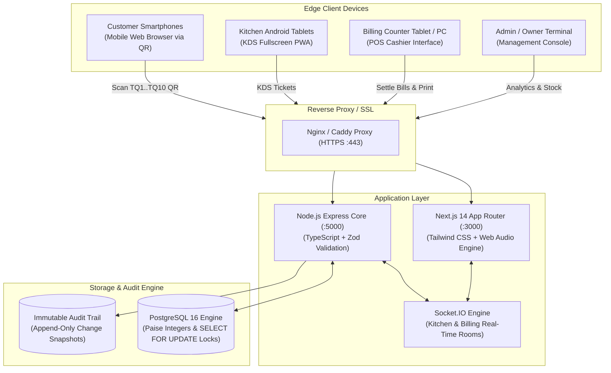
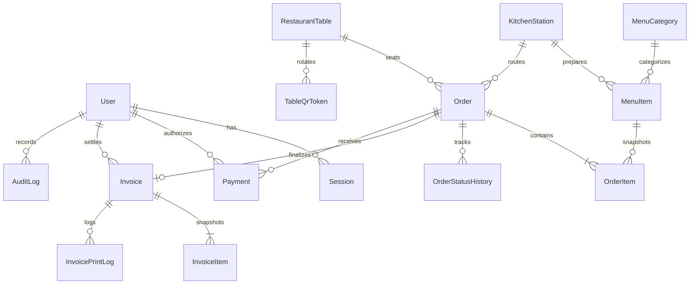

# System Architecture & Technical Specifications
## Ithi Pooram (ഇത്തിപ്പൂരം) - Restaurant Management System

### 1. High-Level Architectural Overview

---

### 2. Database Entity Relationship (ER) Diagram

---

### 3. Core Business & Concurrency Rules
1. **Paise Precision**: All monetary figures (`pricePaise`, `subtotalPaise`, `taxPaise`, `grandTotalPaise`) are stored as 64-bit integer paise (`1 INR = 100 paise`) to prevent floating-point rounding discrepancies.
2. **Indian Tax Calculation (GST 5%)**: Split exactly into 2.5% CGST and 2.5% SGST. Rounded to nearest integer paise.
3. **Business Day Cutoff (03:00 AM IST)**: For night service dining, any order placed before 03:00 AM IST is attributed to the preceding operational business date shift.
4. **Idempotency Protection**: Customer orders carry a client-generated UUID idempotency key preventing duplicate order placement during poor network connectivity or rapid double-taps.
5. **Row-Level Billing Locks**: Final payment confirmation executes inside a PostgreSQL `SELECT FOR UPDATE` transaction. If two cashiers attempt to settle the same table order simultaneously, only the first transaction commits; the second fails gracefully with `ORDER_ALREADY_PAID`.
6. **Immutable Snapshots**: When an order is placed, item names, prices, and notes are frozen into `OrderItem`. Subsequent price updates by management do not alter historic sales or open orders.
